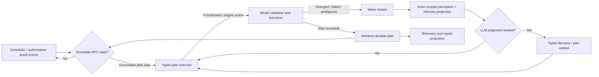

# Millhaven Generation 23 - Event-driven NPC execution

## Goal

Reduce routine LLM calls and prompt cost without giving NPCs hidden world
knowledge or weakening authoritative rules. Generation 23 should let an NPC
plan a bounded sequence once, execute ordinary steps in code, and call the LLM
only when a plan needs judgment or new personally relevant information arrives.

This is a consolidation and reliability generation, not a new world simulation.
It builds on the existing daily planner, anti-idle/event waits, physical
communication, strict action schemas, prompt codec and compression evaluation.

## Implementation status

The first implementation slice is available behind explicit opt-ins:

- `VillageConfig.typed_execution=true` executes eligible engine candidates and
  strict model-emitted plan steps without another decision call.
- `ProxyConfig.message_perception_delta=true` uses a self-contained current /
  changed / unchanged actor perception envelope.
- Story consumers can select `narrative`, `sitrep` or `bluf` without changing the
  canonical incremental story store.
- Existing saves and scenarios retain legacy behavior because both execution and
  perception-delta settings default to false.

The typed executor, privacy-safe contact view, physical fan-out diagnostics,
per-report projection and UI controls are implemented. Matched model quality,
cost and seven-day reliability gates remain release measurements rather than
claims of production default readiness.

A runtime smoke test may generate `millhaven-generation-23` with:

```powershell
.\.venv\Scripts\python.exe -m npc_sim.living_village --base data\scenarios\millhaven-expanded.json --output data\scenarios\millhaven-generation-23.json --force --anti-idle --typed-execution
```

### Smoke-run evidence (2026-11-24)

A restarted local server ran `millhaven-generation-23` from 05:00 to 06:40 and
paused safely with no errors. The persisted run recorded 36 authoritative
actions, 26 proxy requests, 20 accepted model decisions and 16 deterministic
plan steps. Four work actions, two local inspections, four travel actions and six
breakfast actions ran without a decision call. Every action outcome was applied;
the observed proxy-request reduction was 27.8% for this short start-of-day
sample. Six residents ate breakfast through queued typed steps at the wake
boundary. This smoke evidence does not satisfy the full matched one-day or
seven-day release gates.

### Snapshot failure and correction (2026-11-24)

The first typed-execution snapshot run failed at 10:50 because closed breakfast
service continued to appear as a deterministic `village_eat` candidate.
Residents spent repeated turns on actions the world rejected with
`BREAKFAST_CLOSED`, while accepted bread shipments remained unhandled. The
successful all-LLM baseline completed the same snapshot in 63 actions and 63
calls; the failed typed run reached 108 actions and 45 calls before defeat.

Generation 23 now applies the meal service window during candidate generation.
A missed breakfast remains eligible for explicit/model-driven recovery while
service is open, but it is not offered as a deterministic action after cutoff.
A focused logistics regression verifies that closed breakfast no longer masks
freight candidates. Prompt/call savings are not a release gain if deterministic
scheduling starves deadline-critical physical work.

## Decision on the suggestions

| Suggestion | Decision | Generation 23 treatment |
|---|---|---|
| Wake NPCs on events, not every tick | **Implement P0** | The largest expected gain. Extend the existing event-wait/context-revision machinery into the controller scheduler and suppress LLM calls while a code-executable plan is active. |
| Plan once, then execute in code | **Implement P0** | Convert daily planning from an auditable rationale into durable, typed, resumable steps. The LLM plans when necessary; deterministic code executes and validates each step. |
| Remove non-judgment work from the LLM | **Implement P0** | Centralize route calculation, inventory, prices, availability, deadlines and target resolution behind typed engine operations. Never expose omniscient location data. |
| Use typed actions instead of narrated ones | **Implement P0** | Keep the strict action response. Add typed plan/execution records so prose is used only for dialogue, concise explanations and reports. |
| Send only perceived changes | **Implement P1, safely** | Build an actor-scoped observation delta for prompt reduction, but retain enough base/context that every request is self-contained. Do not depend on proxy-retained history. |
| Order prompts for caching | **Implement P1, provider-dependent** | Put invariant instructions first, actor-stable identity next, then episode state. Measure provider-reported cache reads; do not assume savings. |
| Tiered memory | **Implement P1** | Keep exact recent events, canonical summaries of older events, and a bounded structured fact set with provenance. Persistent history remains complete. |
| Batch the DM | **Implement only for ambiguous rulings** | One progress review can cover multiple actions; the engine should continue adjudicating deterministic validity without an LLM. A per-action DM call is unnecessary. |
| Broadcast instead of pairwise chat | **Implement as physical fan-out only** | One notice remains one authored/recorded fact that multiple eligible readers can consume. It must not become remote knowledge or wake a reader that did not receive the message through an enabled channel. |
| Delta protocol/opaque references | **Defer** | The current standalone OpenAI-compatible endpoint has no retained-state contract. Keep requests self-contained until a proxy explicitly supports authenticated revisions and baselines. |
| Omniscient `locate Garrick` | **Do not adopt literally** | Add `resolve_known_contact` or an equivalent query that returns only public schedule facts, last personally observed location and received messages. Hidden current whereabouts remain private. |

## Normative delivery and route requirements

The key words below use RFC 2119-style meanings for implementation and test
acceptance.

### REQ-001: Delivery coordination

- The buyer **MUST** own the funded supply request.
- Other NPCs **SHOULD** offer transport rather than create competing purchase
  requests for the same buyer need.
- The supplier **MUST** allocate the resulting outgoing shipment or request a
  carrier; the buyer MUST NOT become the default dispatcher of supplier stock.
- The system **MUST** identify the assigned carrier and quantity for every
  unpicked load.
- The system **MUST NOT** count an offer as delivery until physical pickup,
  travel and unload are complete.

### REQ-002: Route planning

- An NPC **SHOULD** plan a route once and follow it until its destination or a
  material condition changes.
- The NPC **MUST NOT** re-plan or reverse a still-valid route merely because it
  becomes runnable again.
- Route changes **MUST** be justified by `GOODS_READY`, a personally learned
  message, a confirmed appointment, due meal/rest, blocked edge, or failed
  precondition.
- Shipment and route planning **SHOULD** account for known appointments, pickup
  readiness, travel plus handling time, and the return leg.

### REQ-003: Shipment communication

- The system **MUST** send confirmed status after pickup and delivery.
- The system **SHOULD** inform only eligible carriers when a load becomes ready.
- Once required quantity is fully assigned, NPCs **MUST NOT** search for more
  carriers or create duplicate assignments.
- A carrier **MUST NOT** travel to a pickup site before that shipment is marked
  `ready`; an `assigned` shipment waits at the current site for `GOODS_READY`.
- A manifest **MAY** reveal only the route edges needed for its named pickup and
  destination, not the full hidden route map.

### REQ-004: Work priorities

- An NPC **SHOULD NOT** leave its workplace to investigate an order that a
  confirmed tin-can message can resolve.
- Production and delivery commitments with an at-risk deadline **MUST** take
  priority over optional work, research, routine return travel and inspections.
- The innkeeper **MUST NOT** become the routine carrier for goods needed by an
  active cooking service when another feasible carrier exists.
- A blocked `STOCK_SHORTAGE`, closed meal, or unchanged message **MUST NOT** be
  retried through a deterministic step until relevant personal state changes.

## Communication-format decision

The proposed formats solve different problems and should not replace one
another:

| Format | Use in NPCSIM | Runtime option? |
|---|---|---|
| BLUF | Very short operator summaries: answer first, then evidence/impact | **Yes** |
| SITREP | Village/episode status reports: situation, progress, blockers, next checks | **Yes, default for operational reports** |
| ADR | Durable architecture and trade-off decisions | **No**; use for documents such as this plan |
| RFC 2119 | Schemas, policies and acceptance requirements | **No**; use as an authoring convention where normative language matters |
| ASD-STE100-style controlled language | Concise engine diagnostics and UI labels | **Use selectively**, not as a selectable style |

The format selector should apply to **human-readable reports and copied
summaries**, not canonical events, LLM action schemas, durable transcripts,
world state or the spoken dialogue of an NPC. Supported report values can be:

- `narrative`: current prose/default compatibility mode;
- `sitrep`: Situation, Progress, Blockers, Next action;
- `bluf`: conclusion first, followed by compact evidence.

Report formatting must be a projection of the same canonical facts. Changing it
must not change simulation behavior or model inputs.

## Current foundation

- [village planning](npc_sim/village_planning.py) persists daily plans and
  recalculates on material order changes, but its `actions` are prose rather than
  an executable plan contract.
- [fallback policy](npc_sim/village_fallback.py) already has context revisions,
  blocked-action suppression, event waits and wake reasons.
- [village scheduler](npc_sim/village_turns.py) advances to a resident's future
  availability, but the controller still asks the LLM after selecting every
  runnable actor.
- [village observation](npc_sim/village_ai.py) applies actor-scoped state and
  physical-communication constraints, but contains a large repeated policy
  string and no explicit unchanged/changed envelope.
- [prompt context](npc_sim/prompt_context.py) and the [prompt codec](npc_sim/prompt_codec.py)
  bound/reformat context, deduplicate values, select memory and aggregate exact
  repeated events.
- [proxy](npc_sim/proxy.py) records compression and cache-read telemetry where
  the provider supplies it.
- [communication](npc_sim/village_communication.py) supports versioned physical
  notices, personal receipt, local interruption and optional instant messaging.
- The model action output is already strict JSON. The missing piece is a typed,
  durable executor beneath that output.

## Target architecture



### Durable plan contract

Add a versioned, typed plan for each NPC. A plan step contains:

- stable step and plan IDs;
- intent (`travel`, `acquire`, `produce`, `deliver`, `wait`, `communicate`, `rest`);
- typed action ID and validated arguments;
- origin, deadline, earliest start and optional latest start;
- prerequisite evidence IDs/revisions;
- resume position and attempt count;
- expected world-state revision or interruption set;
- interrupt reasons that require replanning;
- terminal status (`pending`, `active`, `succeeded`, `blocked`, `cancelled`, `superseded`).

Plans are bounded. A generated plan MUST NOT contain an unbounded loop. Waiting
steps name the next concrete event or deadline and a maximum review time.

### Executor ownership

Code may execute only engine-defined deterministic operations. It may:

- choose a shortest route from the authoritative route graph;
- walk an already committed route one step at a time;
- verify local stock, cargo, prices and capacity;
- execute an unchanged typed step with a matching precondition revision;
- wait until a registered event/deadline without calling the LLM;
- mark a step blocked with a reason and wake payload.

Code MUST NOT select a new interpersonal commitment, reinterpret ambiguous
dialogue, infer another resident's intent, create stock, grant knowledge or
silently change an NPC goal. Those conditions require a model decision or a
human/operator action.

### Wake reasons

Canonical wake reasons include:

- plan completed or exhausted;
- step precondition failed;
- accepted, rejected or changed personal order/notice;
- local encounter or direct conversation;
- locally perceived incident/noise/entity/tool change;
- due meal, rest, work or appointment;
- delivery/cargo/price/deadline change;
- route blocked;
- mandatory safety review;
- operator intervention.

An unchanged timer, repeated board version, remote stock change or unrelated
resident activity MUST NOT wake the NPC.

## Implementation phases

### P0.1: Instrument the baseline

1. Add one decision-cycle record with plan state, wake reason, actor context
   revision, request source and whether the LLM call could have been avoided.
2. Add counters for deterministic steps, model decisions, interrupted plans,
   replans, wait wakeups, suppressed duplicate retries and per-NPC prompt tokens.
3. Freeze a short Millhaven fixture containing idle waits, a successful physical
   walk/delivery path, a local message, a failed precondition and a delayed task.
4. Compare Generation 23 candidates against the same seed, model and episode
   configuration. Record authoritative world outcomes, not only token savings.

### P0.2: Typed plan execution

1. Add strict Pydantic models for plans, steps and wake records, with save/load
   migration defaulting old runs to a non-executable/audited-plan state.
2. Change `village_daily_plan` output from prose-only actions to typed step
   candidates plus the existing human-readable rationale.
3. Add an executor that validates one step, dispatches it to the existing world
   action path and atomically records progress after an authoritative result.
4. On rejection, record the exact precondition mismatch and produce a replan
   request. Do not replay the failed step merely because the actor becomes
   runnable again.
5. Keep free-form `plan` text in the LLM response for explanation/compatibility,
   but treat typed `plan_steps` as the only executable output when present.
6. Preserve old saves and scenarios by falling back to the current LLM-per-turn
   behavior until a plan-enabled policy is explicitly active.

### P0.3: Event-driven controller

1. Move runnable reason selection into one scheduler interface: future timer,
   code step, conversation, judgment wake or idle LLM decision.
2. Let the scheduler execute code-ready plan steps without creating proxy
   messages.
3. Suspend the NPC on a registered future event after a wait step. Other NPCs
   continue normally.
4. Deliver wake events through the actor's personal knowledge boundary and
   increment the actor's context revision only for material changes.
5. Preserve durable action boundaries, request IDs and restart recovery. A
   controller restart must resume or safely re-evaluate the persisted step; it
   must not duplicate dispatch, stock movement or payment.
6. Make repeated scheduler wake deduplication explicit and test overlapping local
   events, conversation interruptions and cancelled waits.

### P0.4: Deterministic lookups and privacy

1. Extract non-judgment helpers for route, availability, stock, price, cargo,
   freshness and deadline feasibility.
2. Expose concise blocker fields after failed attempts: required channel, site,
   needed resource, amount, capability, earliest retry and changed-input key.
3. Add a privacy-safe contact resolver. It may combine public schedules,
   personal sightings, personally received appointments and message contents;
   it must never read another resident's current authoritative location from the
   privileged dashboard.
4. Reduce action arguments where the engine can safely resolve a target from a
   selected order, product or appointment ID. Keep dialogue text natural.

### P1.1: Perception projection and prompt prefix

1. Give each observation a revision and a stable actor-visible digest.
2. Build changed/unchanged sections from consecutive actor observations.
3. Keep the request self-contained: include compact current essentials plus the
   selected changes and source revisions. An omitted unchanged fact is not a
   negative fact.
4. Put invariant world/action rules first, actor-stable persona second, and
   volatile current state last. Avoid moving persona data into the episode-state
   suffix when it changes infrequently.
5. Measure provider cache-read tokens independently from token reduction. If a
   provider returns no cache telemetry, report cache status as unavailable.

### P1.2: Tiered memory

1. Define three tiers:
   - recent events retained in full within a bounded window;
   - summarized older events with source event IDs, first/last time and semantic
     outcome;
   - retained facts for debts, promises, appointments, trust and enduring
     knowledge, each with source and confidence.
2. Generate summaries deterministically first. Use a model only for narrowly
   defined narrative compression with source-ID validation; reject unsupported
   claims.
3. Keep the canonical event store, journals and transcripts complete. Memory
   compression is prompt construction only.
4. Rehydrate exact source records when an active action references a summarized
   fact and exact wording/terms matter.

### P1.3: Message/report fan-out and DM batching

1. Treat noticeboard posting as one authored version and many personal reads.
   A recipient wakes only on its own receipt/read event, or on an enabled
   instant-message policy.
2. Add idempotent fan-out diagnostics: authored versions, eligible recipients,
   actual readers, wakes and suppressed duplicate receipts.
3. Keep deterministic action validation in code. Reserve DM/LLM review for
   ambiguous requests, progress reviews and appeals.
4. Batch a progress review at the scheduler boundary after a round, meaningful
   state change or configured action interval. Do not run one DM call for each
   ordinary action rejection already explained by the engine.
5. Add `narrative`, `sitrep` and `bluf` projections to Story/export/operator
   summaries. Store/report the selected format in UI preferences or episode
   report preferences without changing the frozen simulation configuration.

## Required data and API changes

Likely implementation surfaces:

- [npc_sim/models.py](npc_sim/models.py): strict plan, step, wake and report-format
  types;
- [npc_sim/village_planning.py](npc_sim/village_planning.py): typed plan generation
  and material-change reconciliation;
- [npc_sim/village_turns.py](npc_sim/village_turns.py): code-step/event/judgment
  scheduling;
- [npc_sim/controller.py](npc_sim/controller.py): deterministic executor path,
  wake telemetry and model-call suppression;
- [npc_sim/village_fallback.py](npc_sim/village_fallback.py): one material-context
  revision contract and explicit blocked-step cache keys;
- [npc_sim/prompt_context.py](npc_sim/prompt_context.py): perception changes and
  tiered memory projection;
- [npc_sim/proxy.py](npc_sim/proxy.py): typed-plan response and stable-prefix/cache
  diagnostics;
- [npc_sim/village_communication.py](npc_sim/village_communication.py):
  idempotent physical fan-out receipts and contact resolution;
- [ui/src](ui/src): plan progress, wake-reason, saved-call and report-format views.

No canonical history field should be removed to save prompt size. Event-log
compaction, summaries and report styles are projections only.

## Acceptance criteria

### Correctness and privacy

- Code execution never dispatches an unavailable action, invalid argument,
  stale observation request or duplicated physical transfer.
- A failed plan step remains failed until a material precondition changes.
- Save/reload/restart cannot replay committed steps or lose a runnable plan's
  position.
- NPC observations still contain only personally perceived facts and physically
  learned messages. Contact resolution never reveals hidden current locations.
- All stock, money, spoilage, cargo, meal and equipment invariants continue to
  pass the existing focused suites.
- Typed plan steps preserve the same action privacy and validation rules as
  direct LLM decisions.

### Event-driven behavior

- An NPC with an active walk/production/wait plan generates zero LLM decision
  calls while each deterministic step remains executable.
- A newly received personal notice, local encounter or changed precondition wakes
  only the affected NPC.
- An unrelated remote stock or private-plan change does not wake that NPC.
- At least 80% of the steps in the frozen routine fixture run in code without a
  model call; the authoritative outcome matches the normal baseline.
- The complete decision-call count for the fixture falls by at least 50%.

### Token and model quality

- A matched normal-plan baseline is used for behavior comparison, not an
  unconstrained generated episode.
- Prompt bytes/tokens and provider-reported tokens are recorded separately.
- Stable ordering plus measured caching must report the actual cache-read token
  count and cost impact; ordering alone is not counted as a token reduction.
- Event/wake-driven execution plus existing safe compression reduces provider
  prompt tokens per simulated village day by at least 40%.
- Invalid decisions, repairs and authoritative goal failures are no worse than
  baseline. Any absolute tolerance is recorded before the comparison run.
- A relation-sensitive fixture still distinguishes debtor/creditor direction,
  actor/recipient roles and local/remote evidence.

### Communication reports

- BLUF, SITREP and narrative projections represent identical canonical facts.
- Switching report format does not change requests, model calls, plans, events or
  world state.
- SITREP has exactly four labeled sections: Situation, Progress, Blockers and
  Next action. Missing sections say `None`/`No current blocker` rather than
  silently omitting uncertainty.
- BLUF states the result or current risk first and retains links/evidence IDs for
  supporting detail.

## Release gates

1. Focused unit and integration suites pass for planning, scheduling,
   communication, prompt context, compression, save/recovery and report
   projections.
2. A deterministic one-day Millhaven fixture passes unchanged authoritative
   outcomes with event-driven execution enabled.
3. A matched three-run comparison reports action outcomes, valid/applied action
   rate, model calls, prompt tokens, cache reads, latency and wakeups.
4. A continuous same-world three-day run carries stock, orders, cargo, plans and
   memories across midnight without duplicate settlement or lost work.
5. The existing seven-day reliability gate remains required before broad default
   enablement; this generation does not inherit an autonomous pass from unit
   fixtures.
6. Enable event-driven execution first, then perception caching/memory tiers as
   independent experiments. Do not combine failures that cannot be attributed
   to one strategy.

## Rollout

- Stage 1: telemetry only.
- Stage 2: typed plans and code execution behind an episode policy flag.
- Stage 3: event-driven scheduler for the Living Millhaven scenarios.
- Stage 4: perception delta, stable prompt prefix and tiered memory as separate
  experimental settings.
- Stage 5: optional BLUF/SITREP report projection.
- Stage 6: make the winning configuration the default only after correctness,
  cost, latency and seven-day evidence pass. Existing saved episodes retain their
  frozen behavior.

## Risks and non-goals

| Risk | Mitigation |
|---|---|
| A deterministic plan hides a changed world fact | Bind every step to explicit preconditions and wake on material context revisions. |
| Event-driven waits miss a due obligation | Register meal, rest, work, appointment and safety-review wake sources centrally; test overlaps. |
| A planner becomes omniscient | Derive all NPC context through the actor's existing observation and knowledge ledger. |
| Prompt deltas break after reconnect/proxy restart | Keep every request reconstructable and self-contained; no implicit baseline. |
| Prompt compression changes decisions | Keep normal mode, round-trip validation, matched-seed evaluation and authoritative outcomes. |
| Tiered summaries invent memory | Require provenance/source IDs and validate all extracted facts; keep canonical history. |
| Fewer model calls make NPCs repetitive | Use wake reasons, varied typed goals and bounded fallback candidates; preserve explicit judgment for novel social choices. |
| BLUF/SITREP hide nuance | Keep narrative/technical views and canonical evidence available. |

Generation 23 does not add simultaneous parallel LLM execution, remote retained
state, an omniscient village directory, provider-specific prompt-cache tricks, or
automatic sale/order acceptance. Those are separate architecture/security
decisions and are not necessary for the core token and latency gain.
